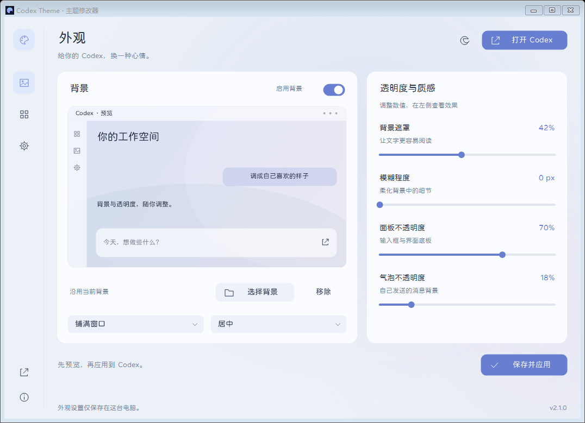
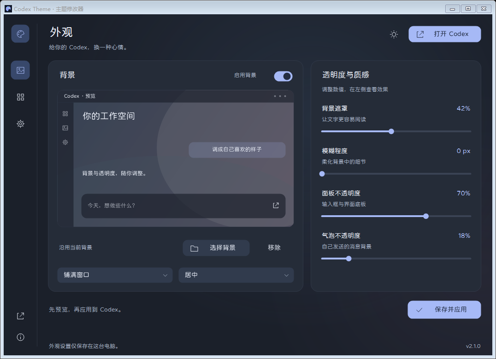

# Codex Theme Modifier

一个 Windows **Codex 主题修改器**：选择自己的背景图片，调整遮罩、模糊、面板和消息气泡透明度，随时关闭或卸载。

**第三方独立项目，与 OpenAI 无隶属关系。** 需要先安装 Windows 官方 Codex 桌面版。本项目不分发 Codex 本体。

[下载最新版本](https://github.com/XiGuaOhh/codex-theme-modifier/releases/latest) · [报告问题](https://github.com/XiGuaOhh/codex-theme-modifier/issues) · [工作原理与边界](docs/architecture.md)



v2.1 重新设计了修改器界面：窄图标侧栏、大幅背景预览、浅色 / 深色 / 跟随系统、圆体文字与柔和卡片。背景、透明度和图片位置可以先预览，再保存应用；安装管理与更新分别位于“管理”“设置”页面。

<details>
<summary>深色界面</summary>



</details>

## 使用

1. 在 Releases 下载 `CodexThemeModifier.exe`，双击打开。首次打开只检测安装状态。
2. 选择图片、调整参数，然后点击 **安装并应用**；已安装时按钮显示 **保存并应用**。“管理”页面也提供单独的安装、修复和关闭入口。
3. 在开始菜单搜索 **Codex（自定义背景）**，从这个入口启动。可以把它固定到开始菜单或任务栏。
4. Codex 标题栏的调色盘按钮位于最小化按钮左边，可以直接调整背景。

如果 Codex 当前是从官方入口启动的，先保存工作，正常退出 Codex，再从主题入口打开一次。修改器不会替你关闭正在运行的 Codex。退出主窗口后仍未生效时，请检查系统托盘中的 Codex 是否也已退出。

支持 PNG、JPG、WebP、GIF、AVIF；单张图片不超过 25 MB、6000 万像素。部分格式由 Codex 显示，修改器可能无法生成缩略图。

## 两种更新

| 更新对象 | 处理方式 |
| --- | --- |
| 官方 Codex | 继续使用官方更新。主题入口每次启动都重新识别当前注册版本，不绑定某个版本的安装路径。更新重启后若没有主题，从主题入口重新打开即可。 |
| 修改器 | 默认在打开控制台时检查本仓库的最新稳定 Release，也可手动点击 **检查更新**。发现新版后，经你点击确认，下载并核对 GitHub 提供的 SHA-256，再替换修改器并重新打开。 |

修改器更新不会主动关闭 Codex。GitHub 不可达时，已安装的主题仍可使用，也可以手动下载新版覆盖更新。没有远程配置、广告或另外的下载站。

从 2.0 / 2.1 升级时如果提示“维护操作未完成”，请先退出修改器，运行新下载的 2.1.1 或更新版本，在“管理”页点击 **重新应用 / 修复**。2.1.1 修复了维护器读取退出中进程信息的竞态；原有背景、设置和 Codex 当前工作保留。

**“跟随官方更新”指自动找到新版官方程序，并不保证未来所有界面都无需适配。** 官方更改界面结构或启动方式后，可能需要发布新的修改器版本；主题加载失败时会保留或打开官方窗口。

## 关闭与卸载

- **关闭主题**：移除当前窗口中的主题外观并停止加载器，保留图片和设置。主题启动入口会转为打开官方程序。
- **卸载修改功能**：移除修改器、加载器和它创建的开始菜单入口。默认保留背景与外观设置，也可取消勾选一起删除。
- 也可从 Windows 的“已安装的应用”找到 **Codex Theme Modifier / Codex 主题修改器** 进行卸载。
- 官方 Codex、账号和聊天资料保留。卸载后完整退出并重开 Codex，本次启动使用的调试参数才会完全消失。

安装文件保存在 `%USERPROFILE%\CodexCustomTheme`，仅对当前 Windows 用户生效，不要求管理员权限。该路径也兼容此项目早期的 1.x 背景加载器；升级会接管旧主题入口，卸载时将已接管的旧官方快捷方式恢复为注册应用入口。早期备份或无法确认归属的文件不会被批量删除。

## 对原版的影响

通过 Windows 注册的官方应用入口运行 Codex，保留其安装身份和原有用户资料。**不修改官方安装包、模型列表、权限、订阅、请求、插件或工具调用逻辑。** 不提供任何绕过官方权限或使用额度的功能。

主题通过仅监听本机的 Chromium 调试连接加载。该接口会增加本地访问面：同机其他程序可能连接端口。修改器会验证端口属于注册的官方进程，只对主聊天窗口和独立聊天窗口加入外观代码；不向网页、插件页面或头像浮层注入。它不通过网络上传你的背景，也不读取聊天内容来工作。

这不是“零风险”承诺。额外的加载器、图片模糊和透明效果会消耗资源，官方界面变化也可能影响适配。可先关闭主题排查问题，再从官方入口启动。[详细说明](docs/architecture.md)

发行程序目前**没有代码签名证书**。请核对本仓库的 Release 来源和 `.sha256` 文件；校验值用于验证下载完整性，不等同于发布者代码签名。

## 构建与检查

Windows 10/11，使用系统 .NET Framework 编译器，无 NuGet 或第三方运行时依赖。运行时需要 .NET Framework 4.8；使用官方 MSIX/商店安装的 Codex。

在 **Windows PowerShell 5.1** 中执行：

```powershell
.\build.ps1
.\tests.ps1
```

输出：`dist\CodexThemeModifier.exe` 和校验文件。版本参数：`build.ps1 -Version 2.1.1`。

可选的实机检查：

```powershell
.\native-tests.ps1
```

实机检查会打开一个独立用户资料的官方 Codex 窗口，验证背景、中文编码、关闭恢复和官方文件完整性；只清理它自己创建的测试进程。不会关闭你原来打开的 Codex。测试产生的隔离资料保存在被 Git 忽略的 `build` 目录。

[已验证的范围](docs/validation.md) · [MIT License](LICENSE)

字体为采用 SIL Open Font License 1.1 的 Token Grove Rounded（由寒蝉全圆体衍生），仅在修改器进程中加载，不安装到系统。授权及来源见 [第三方说明](THIRD_PARTY_NOTICES.md)。

维护者发布新版：在仓库 **Actions → Build, test and release → Run workflow** 中选择 `main` 并填入稳定版本号。构建和检查通过后会自动创建对应标签及 Release，附上程序与校验文件。也支持推送 `vX.Y.Z` 标签发布。已发布版本不会被自动覆盖。
